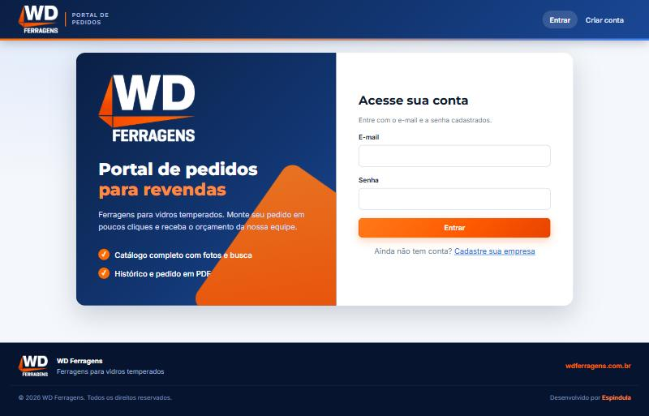
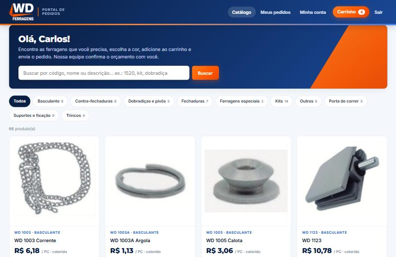
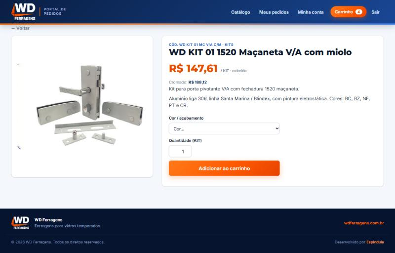
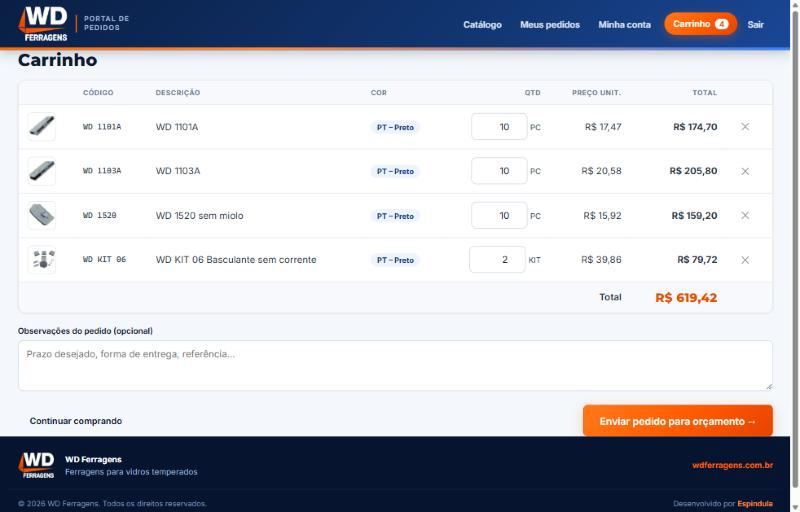
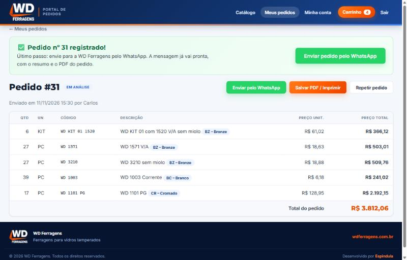
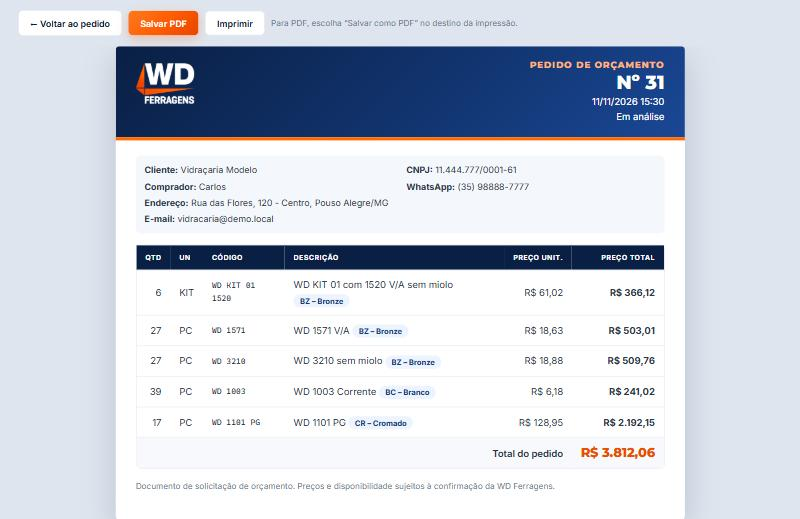
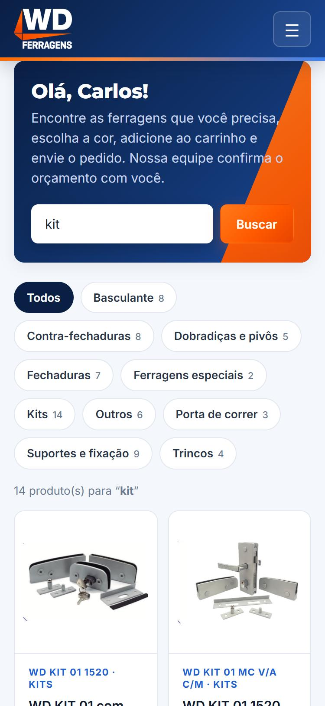
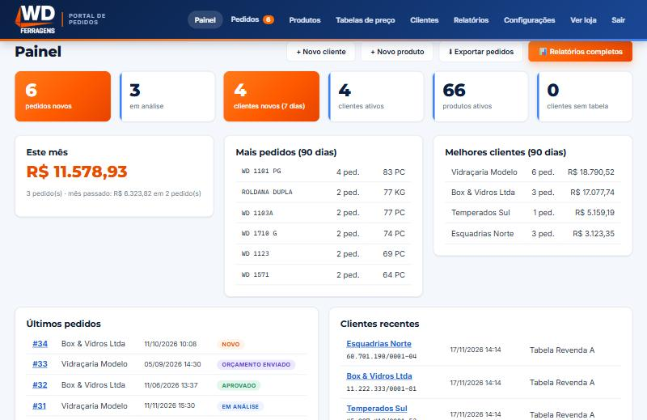
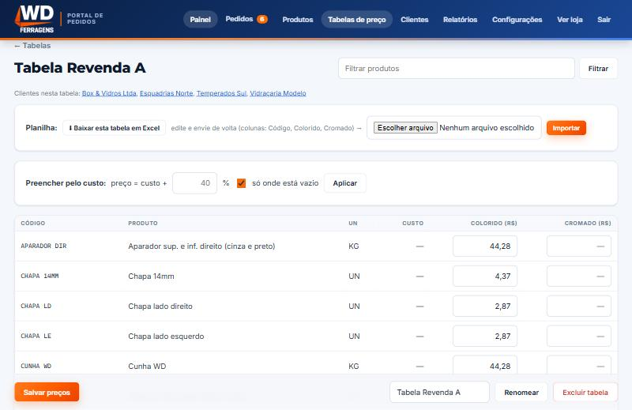

# Portal B2B de Pedidos — WD Ferragens

**Plataforma de pedidos para revendas de ferragens para vidros temperados.**
O cliente monta o pedido com fotos, cores e os preços da sua tabela comercial, envia para orçamento
e a WD Ferragens recebe, responde e acompanha tudo por um painel administrativo completo.

> As imagens abaixo foram geradas com **dados fictícios** de demonstração (clientes, pedidos e preços inventados).
> O portal real é de uso **privado** da WD Ferragens e de seus clientes.

---

## Visão geral

| Para o cliente (revenda) | Para a WD Ferragens (administração) |
|---|---|
| Catálogo com **fotos, busca e categorias** | **Painel** com pedidos novos, faturamento do mês e destaques |
| Escolha de **cor/acabamento** (BC, BZ, NF, PT, CR) com preço colorido e cromado | Cadastro de **produtos**, fotos, cores e preços |
| **Preços da tabela comercial** de cada cliente | **Tabelas de preço** por cliente, importação/exportação em **Excel** |
| Carrinho salvo na conta, com **recálculo instantâneo** | **Clientes**: cadastro, tabela exclusiva, preços especiais, bloqueio |
| Envio do pedido para orçamento + **envio pelo WhatsApp** com PDF | **Pedidos**: resposta ao orçamento, ajuste de preços, custo e margem |
| **Histórico**, repetir pedido e **pedido em PDF** | **Relatórios**: produtos mais vendidos, melhores clientes, cores, categorias |

---

## Experiência do cliente

### Catálogo
Busca por código, nome ou descrição, filtro por categoria e preço conforme a tabela do cliente.

### Produto com cor e acabamento
Cada ferragem tem cores (Branco, Bronze, Natural fosco, Preto e Cromado). Cores coloridas usam o preço
**colorido**; o cromado usa o preço **cromado** — exatamente como na tabela comercial.

### Carrinho
Quantidade e totais são recalculados **na hora**, e o carrinho é salvo automaticamente na conta do cliente.

### Pedido enviado + WhatsApp
Ao finalizar, o cliente envia o pedido para a WD Ferragens pelo **WhatsApp** com um clique: a mensagem já
vai pronta, com o resumo dos itens e um **link seguro do PDF** do pedido.

### Pedido em PDF
Documento pronto para salvar em PDF ou imprimir: quantidade, código, descrição, cor, preço unitário e total.

### Funciona no celular

---

## Painel administrativo

### Painel
Pedidos novos, clientes, faturamento do mês, produtos mais pedidos e melhores clientes.

### Pedido com custo e margem
A equipe responde o orçamento, ajusta preços, muda a situação e gera o PDF do cliente ou o PDF interno com custo.

### Tabelas de preço
Grade de preços colorido/cromado por tabela, preenchimento por markup sobre o custo e importação/exportação em Excel.

### Relatórios
Faturamento por período, comparação com o período anterior, ticket médio e rankings.

---

## Funcionalidades em detalhe

- **Cadastro de empresas** com validação de **CNPJ** (um cadastro por CNPJ), WhatsApp e endereço.
- **Preços por cliente:** tabela comercial (ex.: Tabela A, Tabela B), **tabela exclusiva** por cliente e **preços especiais** por produto.
  Cliente sem tabela vê "Preço sob consulta" e pode pedir mesmo assim — a equipe cota os itens.
- **Cores/acabamentos** com preço colorido × cromado; a cor aparece no carrinho, no pedido, no PDF e nos relatórios.
- **Importação do catálogo** a partir do PDF oficial (recorte automático das fotos) e da tabela de preços em Excel.
- **Pedidos:** situação (novo, em análise, orçamento enviado, aprovado, cancelado), resposta ao cliente, repetir pedido.
- **Envio pelo WhatsApp** via link `wa.me` com mensagem pronta e PDF público protegido por código secreto.
- **Exportação** de pedidos para Excel e **relatórios** com gráficos acessíveis (tooltip e tabela de dados).
- **Equipe**: vários administradores, troca de senha, dados da empresa editáveis no PDF e no site.
- **Segurança:** senhas com bcrypt, sessão em cookie assinado (`httpOnly`, `sameSite`, `secure` em produção),
  escape automático de HTML, proteção contra tentativas repetidas de login e HTTPS.

## Tecnologia

| Camada | Escolha |
|---|---|
| Servidor | Node.js 22 + Express (páginas renderizadas no servidor) |
| Banco de dados | SQLite nativo do Node (`node:sqlite`) — sem serviços externos |
| Interface | HTML + CSS próprio (identidade visual WD: azul-marinho e laranja) + JavaScript leve |
| Planilhas | ExcelJS (importação/exportação) |
| Hospedagem | Oracle Cloud (Always Free), Ubuntu, systemd, Caddy com HTTPS automático (Let's Encrypt) |
| Operação | Backup diário automático do banco e das fotos; publicação por script que nunca toca nos dados |

## Código-fonte

Este repositório é uma **vitrine** do projeto: apresenta as telas e as funcionalidades.
O **código-fonte é privado** e pertence ao projeto da WD Ferragens — não está disponível para download ou reutilização.

---

© 2026 **WD Ferragens**. Todos os direitos reservados. Projeto privado — exibido apenas para fins de portfólio. Nenhuma parte deste material pode ser copiada ou reutilizada sem autorização.

Desenvolvido por **[Espindula](https://github.com/G-Espindula97)**

